

  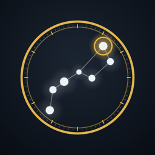

<h1 align="center">ASTRARIUM（アストラリウム）</h1>

  <b>観測地と日時を決めれば、その空をそのまま描くプラネタリウム。</b> 
  The sky for any place and time — computed on your device, so it works where there is no signal.

  <a href="https://apps.apple.com/jp/app/id6795053748">App Store（iPhone / iPad / Mac）</a> ·
  <a href="https://play.google.com/store/apps/details?id=com.avellsky.astrarium">Google Play（Android）</a> ·
  <a href="#使用マニュアル">使用マニュアル</a> ·
  <a href="#user-manual">User manual</a> ·
  <a href="https://astrarium.pages.dev/">サポート / Support</a>

  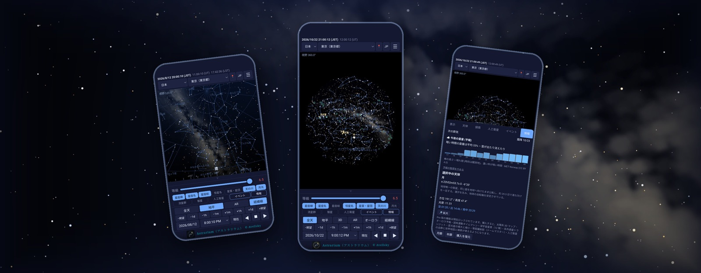

## ASTRARIUM について

天体の位置はすべて端末の中で計算するので、電波の届かない山の上でも全機能が動きます。
広告もアカウント登録もありません。11 の言語に対応し、星座名・恒星名・地名もその言語で出ます。

| | |
|---|---|
| 🌌 **星図** | 恒星 9,096 個（BSC5）、星雲・星団・銀河 155 個（写真と解説つき）、IAU 88 星座の星座線と星座絵、天の川（NASA Deep Star Maps 2020） |
| 🔭 **深宇宙星表** | UCAC4 の 234 万星（12 等まで）。視野を 12 度より狭く拡大すると、肉眼より暗い星が現れます（2.3.1 から無料） |
| 🪐 **惑星と月** | JPL DE421 の暦。視直径・輝面比・距離、木星・土星・火星の衛星の配置 |
| ☄️ **流星群・彗星** | 流星群カレンダーと予想出現数、彗星・小惑星の軌道（MPC / JPL） |
| 📅 **イベント** | 日食・月食、合・衝ほか。過去にも未来にも検索できます |
| 📱 **AR** | 端末をかざした先の空に、星図をカメラ映像に重ねて表示 |
| 🛰️ **人工衛星** | 宇宙ステーションと肉眼で見える衛星の通過予報 |
| ⌚ **Apple Watch** | 今夜の空の要点と、全天を一枚にした星図 |

  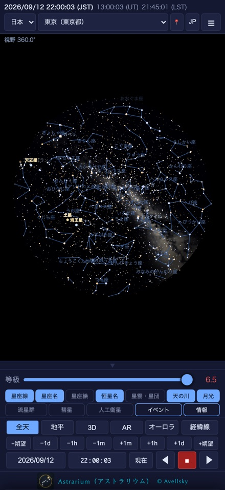
  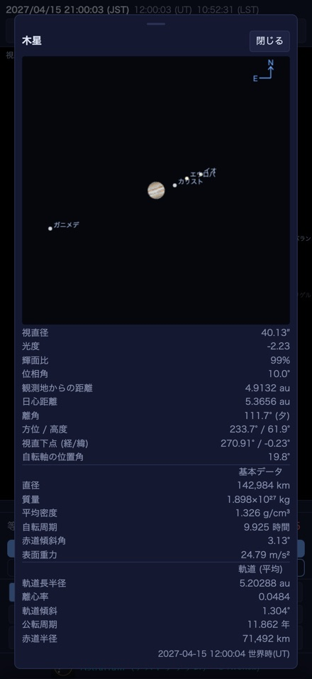
  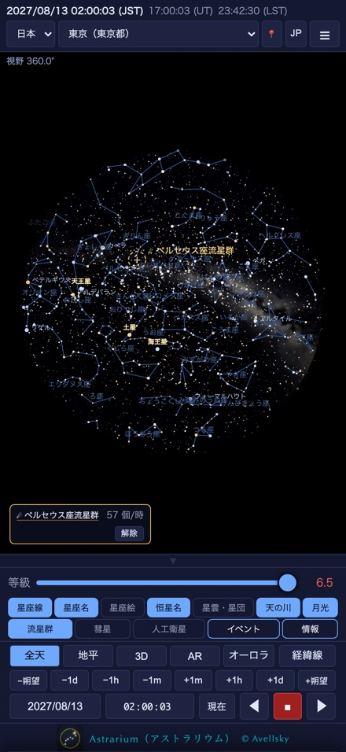
  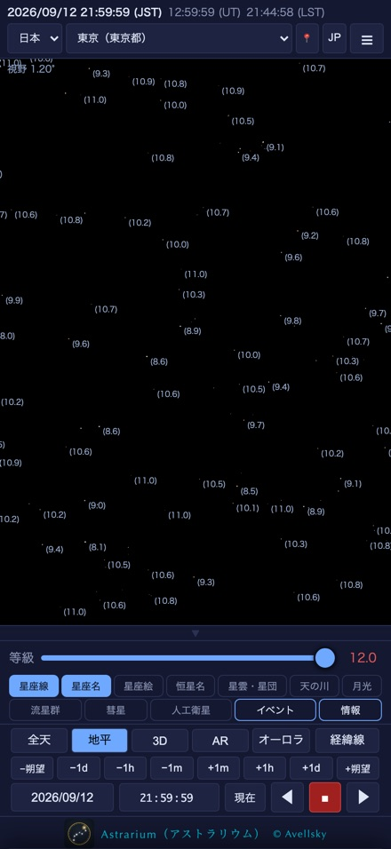

### ASTRARIUM Pro

太陽系3Dマップ（小天体約 156 万個・彗星・準惑星・探査機）、オーロラ予報、固有運動タイムマシン（±5 万年）、
系外惑星のトランジットと変光星の予報、人工衛星の全群と世界地図・地球儀・検索、ドームマスター投影が加わります。
iPhone・iPad・Mac ではアプリ内の購読、Android では別アプリ「アストラリウム プロ」です。

  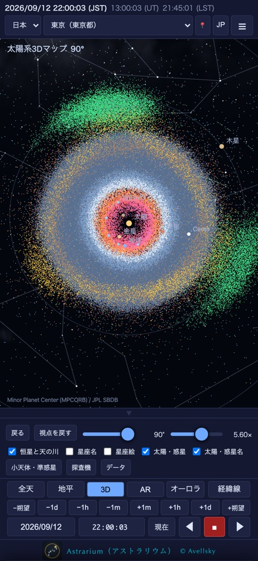
  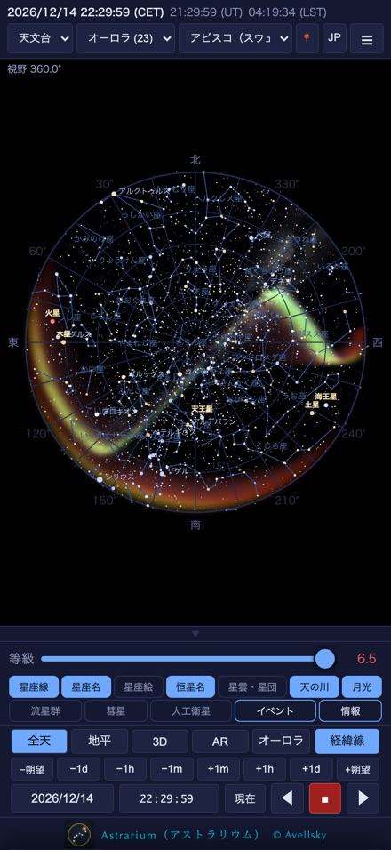
  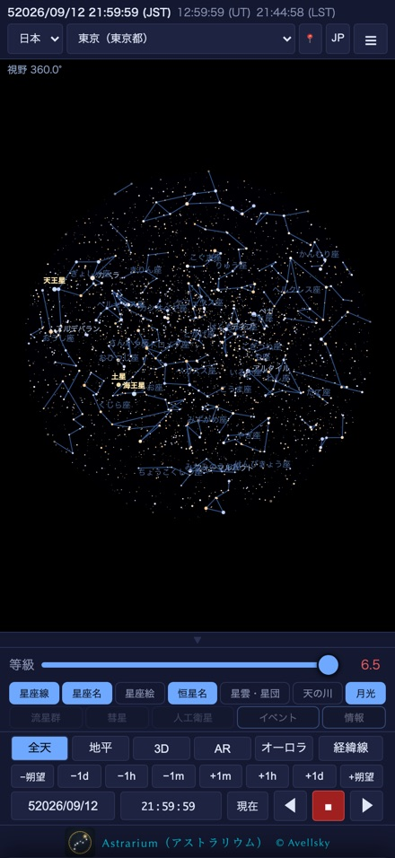
  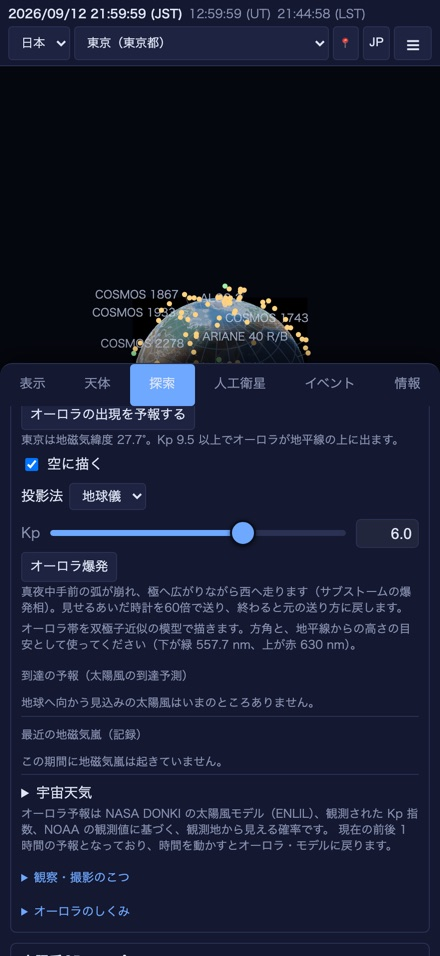

## 使用マニュアル

画面の見かた、操作、流星群の出現数の計算、PNG／PDF 出力まで、実機の画面を添えて説明しています（2.3.1 対応）。

| 版 | PDF |
|---|---|
| iPhone / iPad（Apple Watch は第 12 章） | [astrarium-manual-ja.pdf](manual/astrarium-manual-ja.pdf) |
| Mac | [astrarium-manual-mac-ja.pdf](manual/astrarium-manual-mac-ja.pdf) |
| Android | [astrarium-manual-android-ja.pdf](manual/astrarium-manual-android-ja.pdf) |
| ASTRARIUM Pro（Pro の機能を含む版） | [astrarium-pro-manual-ja.pdf](manual/astrarium-pro-manual-ja.pdf) |

---

  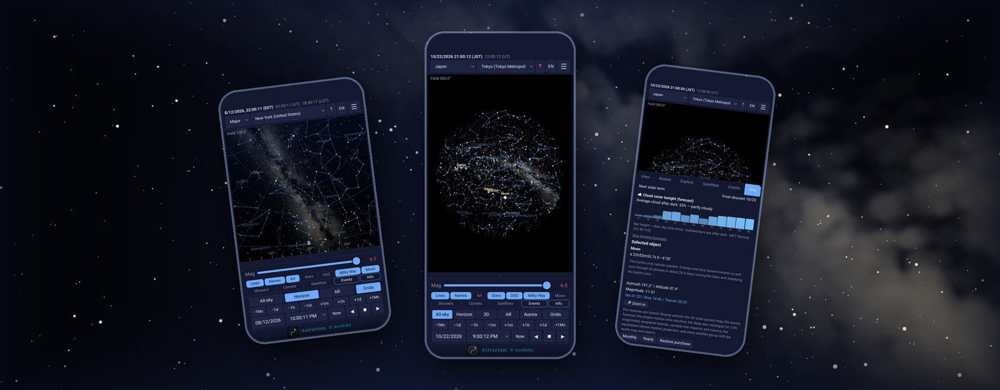

## About ASTRARIUM

Choose a place and a time, and ASTRARIUM draws that sky. Every position is computed on the device,
so the whole app works where there is no signal. No ads, no account, in 11 languages — the names of
constellations, stars and places included.

| | |
|---|---|
| 🌌 **Star chart** | 9,096 stars (BSC5), 155 deep-sky objects with photographs, the 88 IAU constellations with figures, the Milky Way from NASA's Deep Star Maps 2020 |
| 🔭 **Deep star catalogue** | 2.34 million UCAC4 stars to magnitude 12, appearing below a 12° field (free from 2.3.1) |
| 🪐 **Planets and the Moon** | JPL DE421; apparent diameter, phase, distance, and the moons of Jupiter, Saturn and Mars |
| ☄️ **Meteors and comets** | Meteor shower calendar with expected rates; comet and asteroid orbits (MPC / JPL) |
| 📅 **Events** | Eclipses, conjunctions, oppositions and more — search the past and the future |
| 📱 **AR** | Hold the device up and the chart lies over the camera view |
| 🛰️ **Satellites** | Pass predictions for the space stations and the naked-eye satellites |
| ⌚ **Apple Watch** | Tonight at a glance, and the whole sky in one disc |

  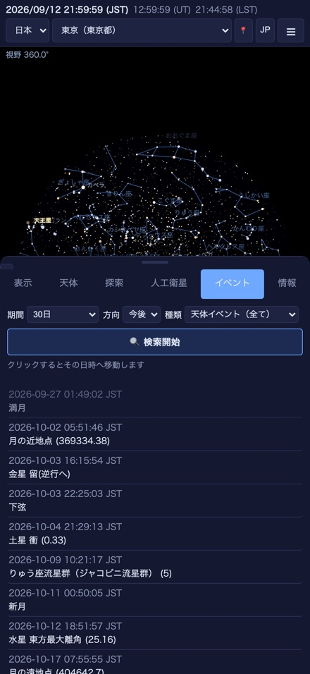
  
  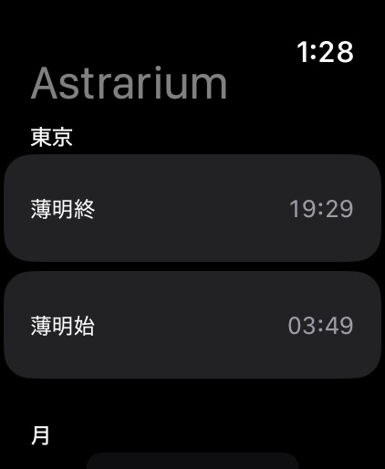
  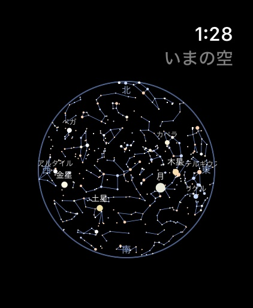

**ASTRARIUM Pro** adds the 3D solar system map (about 1.56 million small bodies, comets, dwarf planets
and spacecraft), the aurora forecast, the proper-motion time machine (50,000 years either way),
exoplanet transits and variable stars, every satellite group with a world map, a globe and search,
and the dome-master projection. On iPhone, iPad and Mac it is a subscription inside the app; on
Android it is a separate app, ASTRARIUM Pro.

## User manual

Screen by screen, with screenshots from the device (for version 2.3.1).

| Edition | PDF |
|---|---|
| iPhone / iPad (Apple Watch: chapter 12) | [astrarium-manual-en.pdf](manual/astrarium-manual-en.pdf) |
| Mac | [astrarium-manual-mac-en.pdf](manual/astrarium-manual-mac-en.pdf) |
| Android | [astrarium-manual-android-en.pdf](manual/astrarium-manual-android-en.pdf) |
| ASTRARIUM Pro (including the Pro features) | [astrarium-pro-manual-en.pdf](manual/astrarium-pro-manual-en.pdf) |

---

ASTRARIUM © 2026 Avellsky · <a href="https://astrarium.pages.dev/privacy-policy.ja">プライバシーポリシー</a> · <a href="https://astrarium.pages.dev/privacy-policy.en">Privacy policy</a>

